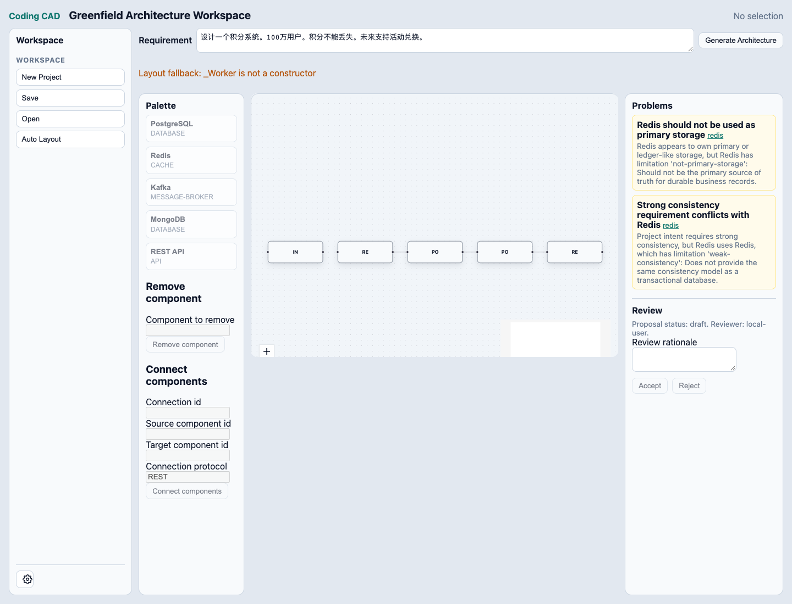

# Phase 3 Exit Report / 阶段3退出报告

日期 / Date: 2026-10-16
分支 / Branch: `codex/phase-3-greenfield-workspace`
收尾前基线 / Baseline: `55b0662`
结论 / Conclusion: **NOT READY TO EXIT / 不满足退出条件**。已完成本次收尾实施、工程验证和报告；不能据本地 CI 通过宣称阶段3全部验收通过。 / The closeout implementation, engineering checks, and report are complete; passing local CI does not establish full Phase 3 acceptance.

## 1. Completed / 已完成

- Review：产品 Accept/Reject 复用 ArchitectureReview 的 create/submit/record/getApproved 状态机。用户于本次明确批准 local-user + 必填理由；拒绝保留候选与正式架构。 / Product Accept/Reject reuse the existing Review state machine. The user approved local-user plus required rationale; rejection retains candidate and accepted architectures.
- 编辑：Add/Remove/Connect 与 Inspector 全部通过显式 command 产生 candidate，经 Validator 后等待用户审批；不再自动批准产品编辑。Remove 沿用现有关联连接级联删除语义，界面要求先确认级联范围。 / All edits create command candidates, validate and await explicit approval. Remove retains existing incident-edge cascade semantics with a visible confirmation.
- Inspector：补齐既有 Contract 的新增/移除，新增结构校验；类型、能力、限制、描述与问题投影有相应产品入口。契约 UI 只新增 name/protocol 与删除，不提供输入输出 schema 编辑器。 / Added existing-Contract add/remove and structural validation, plus controls for existing semantic commands. The contract UI adds name/protocol and removes contracts; no schema editor is included.
- 生命周期：候选/正式 LayoutState 分离，保存正式 snapshot 与独立视图，恢复有效位置并过滤失效 identity，server 为正式 snapshot 记录既有 validation history；修复生成和存储错误路径。 / Separated candidate/accepted LayoutState, saved accepted snapshots and independent views, restored valid positions and filtered stale identities, recorded snapshot validation history, and repaired generation/storage error paths.
- 无新增 package、IR 语义、分支或 Agent 编排；未合并、变基或进入后续阶段；未启动 Coding Agent。 / No package, IR semantics, branch, or Agent orchestration was added; no merge, rebase, later-phase implementation, or Coding Agent launch occurred.

## 2. Acceptance Criteria Result / 验收结果

| Criterion / 标准 | Result / 结果 | Evidence / 证据 |
| --- | --- | --- |
| Requirement -> candidate -> Validator -> Review -> accepted IR | 已实现并验证 / Implemented and verified | `review-gate.test.ts`, `candidate-flow.test.ts`, `canvas.spec.ts` |
| Invalid/rejected/failed approval preserves architecture references; duplicate Accept commits once / 无效、拒绝、审批异常保持引用，重复接受只提交一次 | 已实现并验证 / Implemented and verified | `review-gate.test.ts` uses the production controller / 走真实 controller |
| Add/Remove/Connect visible controls with explicit approval / 真实编辑入口及显式审批 | 已实现并验证 / Implemented and verified | `editing.spec.ts` checks component/connection sets from actual saved/opened architecture / 断言实际存储架构集合 |
| Inspector semantic editing and minimal contracts / 语义编辑和最小契约编辑 | 已实现并验证 / Implemented and verified | `apply-inspector-command.test.ts`, controller tests, structural rule tests, `editing.spec.ts` |
| Save/Open same facts, separate view and valid saved positions / 往返事实相同、视图独立及有效位置恢复 | 已实现并验证 / Implemented and verified | `lifecycle.test.ts`, `host-lifecycle.test.ts`, `editing.spec.ts` |
| Problems navigation and error/recovery paths / 问题导航和错误恢复 | 已实现并验证 / Implemented and verified | `canvas.spec.ts`, `editing.spec.ts`, `lifecycle.test.ts` |
| Default semantic layout understandable without manual rearrangement / 默认语义布局无需手动整理 | **未满足 / Not satisfied** | Actual Chrome displays `Layout fallback: _Worker is not a constructor`; screenshot shows fallback rows / 实际浏览器为退化行布局 |
| Real-browser incremental stability / 真实浏览器增量稳定性 | **已接入未证明 / Integrated but unproven** | Existing incremental API and Node tests pass, but browser solver falls back / 核心测试通过但浏览器 solver 退化 |
| Current source build and complete local CI / 当前源码构建及完整本地CI | 已验证通过 / Verified passing | Raw command outputs below; no cached tasks / 下列输出，零缓存任务 |
| Phase 3 exit / 阶段3退出 | **Blocked / 阻塞** | Layout quality criterion remains open / 布局质量标准未关闭 |

App tests are under `apps/web/src/lib/architecture/`; browser tests are under `apps/web/e2e/`. Contract rule evidence is `packages/architecture-validator/src/validator.test.ts`. / app 测试与浏览器测试按上述目录解析。

## 3. Tests / 测试

All sequential verification ran in writable execution with `CI=true` and `TURBO_FORCE=true`. Turbo reported zero cached tasks. Dependencies were installed and sources rebuilt before tests; existing dist was not substituted for source verification. / 按顺序在可写环境执行；依赖安装和源码重建先于测试，未用既有 dist 替代。

| Command / 命令 | Result / 结果 | Raw output / 原始输出 |
| --- | --- | --- |
| `pnpm install` | exit 0 | [01-install](../logs/validation/p3-closeout/01-install.txt) |
| `pnpm build` | 15/15 tasks, exit 0 | [02-build](../logs/validation/p3-closeout/02-build.txt) |
| `pnpm typecheck` | 25/25 tasks, exit 0; Web 0 errors/warnings | [03-typecheck](../logs/validation/p3-closeout/03-typecheck.txt) |
| `pnpm test` | 30/30 tasks, exit 0 | [04-test](../logs/validation/p3-closeout/04-test.txt) |
| `pnpm --filter @coding-cad/web test:unit` | 14 files / 56 tests, exit 0 | [05-web-unit](../logs/validation/p3-closeout/05-web-unit.txt) |
| `pnpm --filter @coding-cad/web test:e2e` | 18 Chrome tests, exit 0 | [06-browser](../logs/validation/p3-closeout/06-browser.txt) |
| First `pnpm ci:verify` / 首次 | exit 1: missing Step 4 change record / 未同步步骤4记录 | [07-ci-verify](../logs/validation/p3-closeout/07-ci-verify.txt) |
| Rerun `pnpm ci:verify` / 重跑 | exit 0; typecheck 25/25, unit 28/28, integration 18/18, E2E 17/17, build 15/15 tasks | [08-ci-verify](../logs/validation/p3-closeout/08-ci-verify-after-record.txt) |

Final lifecycle regression also passed full source CI with 57 Web unit tests, 9 integration tests and 18 browser tests; see [10-final-source-ci](../logs/validation/p3-closeout/10-final-source-ci.txt). The ordered earlier Web-unit command had 56 tests before the final regression was added. / 最后新增待审命令错误恢复回归后，完整源码CI再次通过，最新计数为57/9/18；早先顺序单测命令为56项，两个结果均保留。

Task counts above are Turbo tasks, not numbers of assertions. Final Web coverage is 57 unit tests, 9 integration tests and 18 browser tests. The default commitlint invocation had no range and checked zero commits; the closeout commit range is checked separately. No GitHub-hosted CI/deployment is claimed. / 表中 task 数不是断言数；默认 commitlint 未提供范围而检查0个提交，收尾提交另做范围检查；不声称远程 CI 或部署通过。

Failure classification / 失败分类：

- Environment / 环境：最初非交互 install 因无TTY中止；CI=true 后成功。此前只读 Turbo 日志错误不属于本次可写源码构建失败。 / Initial install stopped for lack of TTY; CI=true recovered. Earlier read-only Turbo errors are not failures of this writable build.
- Code / 代码：Inspector 选择回调响应式循环、存储错误恢复、视图恢复缺口已修复并回归；ELK 浏览器互操作缺陷仍存在。 / Inspector reactive loop, storage-error recovery and view restoration were repaired and regressed; ELK browser interoperability remains defective.
- Code-delivery record / 代码交付记录：首次完整 CI 被 change-record 正确拦截，补日志后通过。 / The first full CI was correctly blocked by change-record and passed after the log update.
- Test / 测试本身：旧 Inspector 用例假设重布局后仍选中组件；改为真实点击、重选并检查异常，未恢复 synthetic DOM click。 / The old Inspector test assumed selection survived layout; it now uses real clicks, reselects and checks page errors without synthetic DOM clicks.

Independent actual-browser evidence / 独立真实浏览器证据：
[diagnostic JSON](../logs/validation/p3-closeout/09-browser-layout-diagnostic.json) reports fallback, no pageErrors, five Canvas nodes. / JSON 记录 fallback、无 pageErrors、5个节点。

## 4. Architecture Invariants Check / 架构不变量检查

ArchitectureProject remains the sole source of truth. Commands create immutable candidates, Validator analyzes, Review approves, and only approved architecture replaces accepted state. Candidate layout previews never overwrite accepted LayoutState or saved architecture. Invalid endpoints remain Problems and do not enter the solver. App browser code uses typed server contracts; no package imports from apps/web were introduced. / ArchitectureProject 仍为唯一事实源；候选不可变、校验只分析、审批后才更新正式架构；候选布局不覆盖正式布局或存储；非法端点停留在 Problems；浏览器保留 typed server boundary，没有 package 反向依赖 app。

Existing workspace architecture checks passed for 15 modules. This is automated boundary evidence, not a claim of independent external architecture approval. / 15模块架构检查通过；它不是独立外部架构评审批准。

## 5. Known Risks / 已知风险

- Browser ELK failure is a code/interoperability defect, not a permission problem. Fallback keeps the UI usable but does not prove semantic rank, default readability or local movement. / 浏览器 ELK 缺陷与权限无关；fallback 可显示但不证明语义层级、可读性或局部移动。
- Node-only solver tests and passing CI currently do not detect this browser quality failure as an exit-blocking assertion. / Node solver 测试和当前CI尚不能将该浏览器质量失败自动转换成退出阻塞断言。
- Reviewer is the explicitly approved local-user label, not authenticated identity. Proposal/Approval records remain in memory; existing Workspace persists snapshots and validation history, not approval history. / reviewer 为获批的本地标签而非认证身份；审批记录仍在内存，Workspace 保存 snapshot 和 validation history。
- Large ELK chunks and adapter-auto deployment warnings remain; no production environment, mobile/browser matrix or large-graph acceptance is claimed. / 大chunk和部署adapter警告仍在；未验证生产部署、多浏览器平台或大型图。

## 6. Technical Debt / 技术债

Repair ELK/browser-worker interoperability within the approved solver-only boundary, then add an actual-browser assertion of successful solver execution and semantic/incremental quality. Do not silence the warning or count a fallback screenshot as successful layout. / 修复既有 solver-only 边界内的互操作后，补浏览器 solver 成功及语义/增量质量断言；不得隐藏警告或把退化截图算成功。

Minimal contract editing covers only approved add/remove with name/protocol controls; schema-editor UX and persistent approval audit are outside this delivery. / 最小契约编辑按批准范围交付；schema编辑器和审批审计持久化不在本次交付内。

## 7. Decision Required / 待决策

Approval identity/rationale and the P3-D3 contract ambiguity were explicitly resolved by the user on 2026-10-16; see the appended clarification in `architecture-layout-decisions.md` and [Inspector audit](audit/p3-inspector-scope.md). No unanswered approval/Inspector decision remains. / 两项用户决策已明确，无尚未答复的审批或 Inspector 问题。

The ELK defect is not fixed in this closeout. Any proposed repair that changes the D-010 worker boundary, solver selection, package public contract or dependency decision must stop for user confirmation before implementation; this report grants no such change. Persistent approval history also requires a separate scope/format decision if requested. / 本轮未修复ELK缺陷；若修复方案改变D-010边界、solver、package公开契约或依赖决策，必须先确认；本报告不授权这些变化。审批历史持久化若需扩展，也须另行决定。

## 8. Next Phase Readiness and Rollback / 下一阶段与回退

**Phase 4 is not authorized by this report.** Phase 3 remains open until browser solver interoperability and default layout/incremental acceptance are proved. / **本报告不授权阶段4**；阶段3仍待上述真实布局验收。

| Step / 步骤 | Commit / 提交 | Rollback / 回退 |
| --- | --- | --- |
| 1 Review gate / 审批门禁 | `5e2ebdc` | `git revert 5e2ebdc` |
| 2 Remove/Connect / 删除连接 | `8a17817` | `git revert 8a17817` |
| 3 Inspector audit/contracts / 审计与契约 | `b608fce` | `git revert b608fce` |
| 4 Source acceptance/lifecycle / 源码验收与生命周期 | `e243537` | `git revert e243537` |
| 5 Documentation / 文档同步 | This report's commit / 本报告所在提交 | Revert that commit / 回退该提交 |

Each step is a separate commit. Later steps depend on earlier APIs, so a whole-closeout rollback should revert in reverse order (5 -> 1); arbitrary-order reverts may conflict or need dependent-test updates. The original untracked PR draft is preserved. / 每步独立提交；完整回退按5→1倒序，任意顺序回退可能冲突或需同步依赖测试；原未跟踪PR草稿保留。
