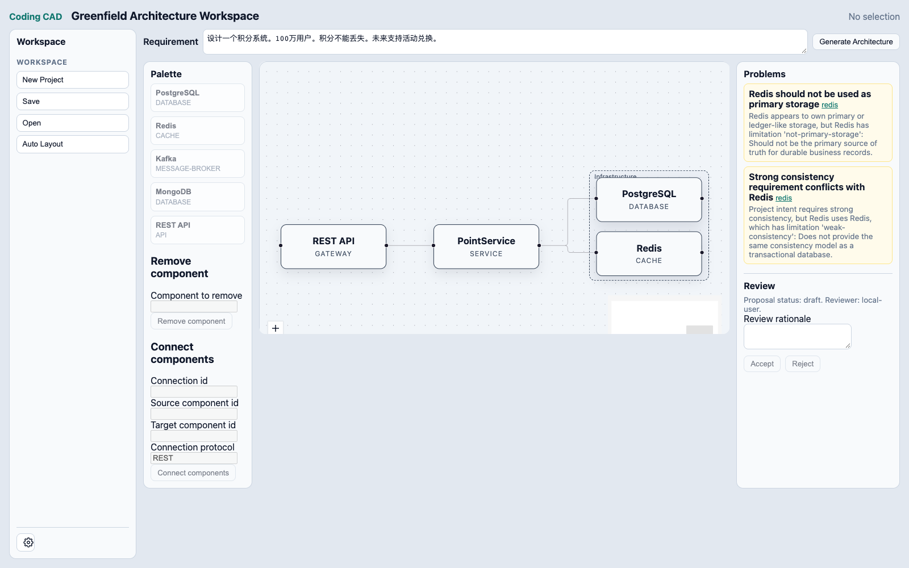

# Browser Layout Quality / 浏览器布局质量

日期 / Date: 2026-10-16。范围 / Scope: Chrome, dev + production preview, workspace-default + existing points-system fixtures. 两个 fixture 均为4组件、1容器、3连接；不代表大型图或其他浏览器。 / Both fixtures contain four components, one group and three connections; this does not establish large-graph or other-browser quality.

## Evidence / 证据

运行 [compare.py](compare.py) 从源码构建，在独立浏览器中分别执行真实 ELK 与 timeout=0 的真实 fallback。后者复用原异常时同一个 fallback generator，是受控对照，不是修复后自然失败；任何正向浏览器测试仍禁止 fallback。基线异常另见 [baseline-modes.json](baseline-modes.json)。 / The script source-builds and measures real ELK and a controlled real timeout fallback in each mode. It uses the same fallback generator as the historical exception. This diagnostic is separate from positive tests, which reject all fallback.

完整数据 / Raw evidence: [dev](comparison-dev.json), [preview](comparison-preview.json). 指标来自既有 LayoutResult/LayoutGraph、rank constraints 与 MOVEMENT_BUDGET；[test helper](../../../../../apps/web/e2e/layout-metrics.ts) 在 app 测试层计算矩形与线段，不改变公开 API。 / Existing result/graph contracts, rank constraints and the movement budget feed app-test measurements without public API changes.

| Metric / 指标 | ELK: both fixtures/modes / 两fixture双模式 | Controlled fallback / 受控退化 |
| --- | --- | --- |
| Status / 状态 | success; diagnostics=[] | fallback; LAYOUT_TIMEOUT |
| Peer overlap / 非包含关系重叠 | 0 | 0 |
| Children outside container / 容器外成员 | 0 | 2 |
| Real routed edges / 实际solver路由 | 3/3 | 0/3 |
| Proper routed crossings / 严格路由交叉 | 0 | null: no routes / 无路由不可测 |
| Preferred-rank inversion / 语义层级倒置 | 0 | default 0; points-system 1 |
| Area / 面积 px² | 183372 | 78624 |
| Identical FULL result on repeated input / 重复输入完全相同 | true | true |
| Incremental mode / 增量模式 | INCREMENTAL | FULL; no movement metrics / 不提供移动指标 |
| Unaffected p95/max / 无关节点移动 | 0/0 px | null, not proven / 未证明 |

Peer overlap excludes intentional ancestor containment; containment is checked separately. Crossings count proper interior intersections of actual routed segments between edges without shared endpoints; collinear touches are not crossings. Rank inversions are observations against existing preferred rank constraints, not a new correctness rule. / 重叠排除祖先包含，另验容器包含；交叉只统计无共享端点边的实际线段内部相交，不统计共线接触；rank倒置为既有偏好约束观测，不新增正确性规则。

## Assertions and Interpretation / 断言与解释

[layout-quality.spec.ts](../../../../../apps/web/e2e/layout-quality.spec.ts) 在两模式断言：真实 ELK；输入不变；FULL重复结果一致；无重叠、正确容器包含；描述编辑后 INCREMENTAL；p95≤48px、max≤144px、无顺序反转。预算已由 [architecture-layout.md](../../../../../docs/architecture-layout.md) 与 MOVEMENT_BUDGET 规定，没有另设通过线。 / Both modes assert real ELK, immutable input, exact determinism, non-overlap, containment and approved incremental movement bounds.

产品真实 command/Validator/Review 描述编辑和 Palette 添加同时测量：无关组件 p95/max=0/0px，无顺序反转；添加后仍无重叠或越出容器。DOM矩形另验无重叠/包含，捕捉 absolute-to-parent-relative adapter错误。 / Actual product editing and palette addition measure zero movement of unaffected components and no order reversal. Addition retains non-overlap and containment; DOM geometry checks also cover coordinate projection.

增量 Stability pass 按原契约清除不再匹配坐标的solver edge routes，交叉指标记null，不能当作“0交叉”或fallback；此时状态仍为ELK success，renderer负责重绘连线。 / Stabilization clears stale routes by existing design, so incremental crossings are null rather than zero. This is a successful ELK layout followed by stability processing, with renderer routing afterward.

默认布局按入口→服务→基础设施组织，容器包住成员，所有组件名称可见；截图过程没有拖动整理。上述指标和截图支持这两个阶段3场景的默认可读性，不推广为任意图保证。更小的fallback面积不等于更好布局，其包含与路由缺失可直接量化。 / Default layouts show entry→service→infrastructure, contained members and visible names without manual repositioning. Evidence supports these Phase 3 cases only; the fallback's smaller area does not offset missing containment and routing.

交叉数、rank inversion、面积和真实浏览器耗时未规定新的硬阈值，只记录实测；若将来用作额外通过线，需用户批准。既有无重叠、确定性和48/144px移动预算不受影响。 / No new pass threshold is imposed for crossings, rank inversions, area or browser elapsed time; future thresholds require user approval. Existing overlap, determinism and movement acceptance remain enforced.

内部验收钩子仅安装于DEV或显式layout-acceptance模式；正常production构建不含该钩子。正向测试全局观察实际Worker结果，独立负控验证fallback必然失败；不靠警告消失推断成功。 / Private hooks are installed only in development or explicit acceptance builds. Normal production excludes them. Worker observations and an expected-failing negative control establish solver success directly.

审批添加后的截图另见 [preview](quality-preview-workspace-default.png)。新增 Kafka 保持无重叠与零旧节点移动，但当前固定viewport会裁切下方新节点，需要pan/zoom查看；未把该截图描述为所有新增节点自动适配viewport。 / After addition, Kafka remains non-overlapping with zero old-component movement, but the fixed viewport clips the new bottom node and requires pan/zoom; automatic viewport fitting is not claimed.
